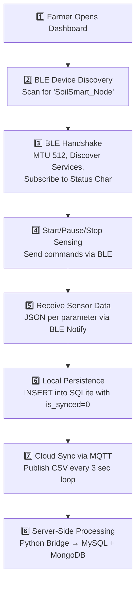

# Rithumitra — Complete PDF Analysis & Build Blueprint

I've analyzed all 7 PDFs. Here's a complete breakdown of every system, the database schemas involved, the algorithms, and exactly what we need to build in our React Native app.

---

## PDF 1: Device to App Flow (Text-based PDF ✅)

This is the **most critical PDF** — it defines the exact data pipeline from the ESP32 hardware to the cloud. Here's the full flow:

### The 8-Step Pipeline



### BLE Commands

| Command | BLE Payload | ESP32 Action |
|---------|------------|--------------|
| Start | `START` | Begin reading sensors every 5 sec |
| Pause | `PAUSE` | Suspend readings |
| Stop | `STOP` | Stop readings, increment Sample ID |
| Refresh | `METRICS` | Force all 7 values to re-transmit |

### Local SQLite Schema: `sensor_readings`

| Column | Type | Notes |
|--------|------|-------|
| `id` | INTEGER | Auto-increment PK |
| `device_id` | INTEGER | From ESP32 |
| `location_id` | INTEGER | From ESP32 |
| `parameter_id` | INTEGER | 1-7 (N, P, K, Moisture, pH, EC, Temp) |
| `value` | TEXT | Formatted string (e.g., "6.5") |
| `timestamp` | INTEGER | Unix epoch seconds |
| `sample_id` | INTEGER | Groups one "scan session" |
| `field_id` | TEXT | User-selected field |
| `is_synced` | BOOLEAN | 0 = pending, 1 = synced |

### MQTT Publish Format
```
Topic: field/telemetry/gateway
Payload: device_id, field_id, parameter_id, value, sample_id, timestamp
Example: 101, Field-01, 5, 6.5, 3, 2024-05-24 10:30:00
```

### Error Handling Strategies

| Scenario | Strategy |
|----------|----------|
| BLE drops | Auto re-scan. Local DB data is safe |
| MQTT unreachable | Sync pauses. Stays in SQLite with `is_synced=0`. Re-syncs on reconnect |
| App closed mid-scan | All data already persisted. Re-opens with full history |
| Invalid sensor data | Firmware filters invalid frames. App validates JSON before insertion |

---

## PDF 2: Single Crop Recommendation Flow


### Algorithm:

1. **Input**: Farmer's field details → Get `soil_id`, `irrigation_id`, `district_id`
2. **Lookup**: Query `Field_Profiles` table using soil_id + irrigation_id + district_id → get `profile_id`
3. **Get Crops**: Query `District_profile_crops` table using profile_id + district_id → get list of suitable crops
4. **Season Filter**: Check if season is Kharif → If NOT Kharif, remove heavy water-requirement crops from list
5. **pH Filter**: From `farmer_field_details`, get pH range → remove crops outside the field's pH tolerance
6. **Paddy Check**: If Paddy is in the list → add Paddy Varieties from `Paddy_Varieties` table
7. **Fertilizer Calc**: For each remaining crop → calculate fertilizer consumption using STCR equations
8. **Risk Analysis**: Add risk score for each crop
9. **PMJY Insurance**: Calculate PMJY Crop Insurance Claim
10. **Rank Engine**: Rank crops by (fertilizer consumption, profit, risk) → Output **TOP suitable crops**

### Database Tables Used:
- `Soil_Types` — soil type master data
- `irrigation_Source` — irrigation types (rainfed, canal, borewell, etc.)
- `districts` — district master
- `farmer_field_details` — the farmer's specific field
- `Field_Profiles` — mapping of soil+irrigation+district → profile
- `District_profile_crops` — which crops grow in which profile + district
- `Paddy_Varieties` — paddy sub-varieties

### Output:
```json
{
  "crop_name": "Paddy (BPT-5204)",
  "fertilizer_consumption": 120,
  "profit_estimate": 45000,
  "risk_score": 2,
  "insurance_claim": 15000,
  "cost": 8500
}
```

---

## PDF 3: Fertilizer Technical Flow (Chemical & Bio)


### Algorithm — Soil Nutrient Analysis → Fertilizer Recommendation:

**Step 1: Prepare Average Sensor Data**
- From `sensor_transaction` table, group by `Field_id`, `Device_id`, `Timestamp`
- Prioritize recent records over old
- Average the N, P, K, Moisture, pH, EC, Temp readings
- Store in `Soil_Testing_raw_Sensors`

**Step 2: Calibrate Raw Values**
- Look up `Farmer_field_Details` → get `soil_id`
- Look up `Farmer_Plant_Details` → get device offsets (`offset_n`, `offset_p`, `offset_k`, `offset_ph`, `offset_ec`)
- Get `Soil_Type` → get `Multiplication_Factor`
- Apply **Calibration Formula**:
  ```
  Calibrated Value = raw_value + offset * Multiplication_Factor
  ```
- For N, P, K specifically:
  ```
  kg/hac = (mg/kg_raw * offset * Multiplication_Factor) / 1000
  ```
- Based on soil_id + moisture value, get coefficients from `Calibration_coefficients` table
- Final calibration: `lab_value = a₁ + a₂*EC + a₃*T + c₅*pH + c₆*moisture + c₇*raw_p`

**Step 3: Get STCR Fertilizer Equations**
- Look up `Fertilizer_dosage_coefficient` table based on `Farmer_id` + `Field_id`
- Get STCR equations:
  ```
  Fn = 0.90*T - 0.56*SN - 0.78*FYM
  Fp = 0.90*T - 0.56*SN - 0.78*FYM
  Fk = 0.90*T - 0.56*SN - 0.78*FYM
  ```
  Where: T = Target yield, SN = Soil Nutrient, FYM = Farm Yard Manure

**Step 4: Identify Nutrient Status**
- Based on the latest field record, classify each parameter as **Low / Medium / High**
- If **ALL parameters are High** → "No Bio Fertilizer is required"
- If any parameter is **Low/Medium** → Identify which nutrient needs supplementation

**Step 5: Bio Fertilizer Recommendation**
- For nutrients marked Low/Medium, look up bio fertilizer from master table
- Bio fertilizer contributes: `FN = FN - contribution_from_bio`, `FP = FP - contribution_from_bio`, `FK = FK - contribution_from_bio`

**Step 6: Chemical Fertilizer Calculation**
- Calculate dosage for hectare
- Look up `Fertilizer_Nutrient_Percentage` table
- Formula: `Required_Fertilizer_Dosage = Required_Fertilizer_quantity * 1000 / Nutrient_Percentage`
- Final output from `Fertilizer_Recommendations` table

**Step 7: Commercial Products**
- Map to real fertilizer products: id, crop_id, Bio Fertilizer name, Nutrient it satisfies, Contribution to soil, Usage Method, Approximate cost

---

## PDF 4: Inter-Crop Recommendation Flow


### Algorithm (Similar to Single Crop, but with combinations):

1. **Input**: Same as single crop — soil_id, irrigation_id, district_id
2. **Field Profiles**: Same lookup via `Field_Profiles` table
3. **Inter-Crop Table**: Instead of `District_profile_crops`, queries `InterCrop_table` which has:
   - `District_id`, `Profile_id`, `Combination_id`
   - `Crop_1_major`, `Crop_2_minor` — the major + minor crop combo
   - `Ratio_of_Yielding` — e.g., "70:30" split
   - `Target_Yield_major_crop`, `Target_Yield_minor_crop`
   - `Season_preferable`
   - Crop with **Variety Name**
4. **Fertilizer Calculation**: For each crop in the combination, calculate fertilizer independently, then **sum** the two fertilizer requirements
5. **Same ranking**: Risk analysis + PMJY insurance + Rank by (fertilizer, profit, risk)
6. **Output**: JSON with combination name, combined fertilizer consumption, cost

---

## PDF 5: Daily Activity / Crop Planner


### System Design:

**Master Tables:**

| Table | Columns |
|-------|---------|
| `Crops` | Crop_name, Crop_id, Crop_image_url |
| `Crop_Variety` | Crop_id, Variety_id, Variety_Name, Single_crop_recommended, Inter_crop_recommended, Duration, Season_prefer |
| `Activity` | Activity_id, Activity_name, Estimation_time, General_Description |

**Configuration Table: `Crop_Configuration_Master`**

| Column | Purpose |
|--------|---------|
| Crop_id | Which crop |
| Variety_id | Which variety |
| Activity_id | Which farming activity |
| Start_day | Day number to start (from sowing) |
| End_day | Day number to end |
| Description_of_activity | What to do |

**Generated Planner: `Crop_Planner`**

| Column | Purpose |
|--------|---------|
| Farmer_id | Which farmer |
| Field_id | Which field |
| Crop_id | Selected crop |
| Variety_id | Selected variety |
| Activity_id | The activity |
| Start_date | Actual calendar date (sowing date + start_day) |
| End_date | Actual calendar date (sowing date + end_day) |
| Description_Activity_id | Description text |
| Status | Done / Pending / Skipped |

### Flow:
1. Farmer chooses a crop from the recommendation screen
2. System looks up `Crop_Configuration_Master` for that crop + variety
3. Based on the **sowing date** the farmer enters, it generates actual calendar dates
4. Creates entries in `Crop_Planner` with status = "Pending"
5. App shows a **daily task list** — what to do today, tomorrow, etc.

---

## PDF 6: Soil Health Correction


### Simple Decision Tree:

**Input Table: `Soil_Available_Nutrients`**

| Farmer_id | Field_id | N | P | K | PH | EC |
|-----------|----------|---|---|---|----|----|

**Logic:**
1. Check nutrient status for each of N, P, K, PH, EC
2. **Decision diamond**: Is the nutrient status **High** or **Low/Medium**?
   - **If High** → "Apply Green Manure and Farm Yard Manure for increase Organic Carbon which increase the biological activity of soil"
   - **If Low/Medium** → Look up bio-fertilizer corrector table

**Corrector Table:**

| Fixer_id | Parameter | Bio_Fertilizer_name | Usage_Description | Dosage_kg/hac |
|----------|-----------|---------------------|-------------------|---------------|

---

## PDF 7: SMS API Usage Guide (Text-based ✅)

### SMS Gateway Details:
- **Provider**: VIEWIN Transactional SMS Gateway
- **API Endpoint**: `https://202.158.250.140/fe/api/v1/send` (GET request)
- **DLT Content ID**: `1707177859908335883`
- **DLT Principal Entity ID**: `1201159188619220464`
- **Message Template**: `Welcome to View Win App! Use OTP {otp} to complete your Registration. Valid for 10 minutes.`

> [!WARNING]
> The credentials are in the PDF. These should be stored as environment variables on the backend, never in client-side code.

---

## What We Need to Build — Complete Requirements

### Phase 1: Core Device Integration (BLE + SQLite + MQTT)

| # | Feature | Library Needed | Priority |
|---|---------|---------------|----------|
| 1 | **BLE Service** — Scan, connect, subscribe to ESP32 | `react-native-ble-plx` | 🔴 Critical |
| 2 | **Local SQLite DB** — Store sensor readings offline | `react-native-sqlite-storage` or `op-sqlite` | 🔴 Critical |
| 3 | **MQTT Service** — Publish buffered data to HiveMQ | `mqtt.js` (via WebSocket WSS port 8884) | 🔴 Critical |
| 4 | **Sensor Repository** — Coordinate BLE → SQLite → MQTT | Custom Zustand store | 🔴 Critical |
| 5 | **Device Connection Screen** — BLE scan + connect UI | Custom screen | 🔴 Critical |
| 6 | **Sensor Dashboard** — Real-time 7-parameter display | Custom screen | 🔴 Critical |
| 7 | **Transmission History** — Show synced/unsynced readings | Custom screen | 🟡 Medium |

### Phase 2: Profile & Field Management

| # | Feature | Details |
|---|---------|---------|
| 8 | **Profile Setup Screen** — Farmer name, location, device_id, holding_acres | Already has placeholder |
| 9 | **Field Management** — Add/edit/delete fields with soil_id, area, GPS, crop | CRUD operations |
| 10 | **Field Selection** — Pick active field for sensor readings | Dropdown/picker |

### Phase 3: Recommendations & Intelligence

| # | Feature | API Endpoint |
|---|---------|-------------|
| 11 | **Single Crop Recommendation** — Top crops for a field | `POST /recommend/auto` |
| 12 | **Inter-Crop Recommendation** — Best crop combinations | Separate API endpoint |
| 13 | **Fertilizer Recommendation** — Chemical + Bio fertilizer details | Part of recommendation response |
| 14 | **Soil Health Report** — Nutrient status (Low/Med/High) with corrections | Calculated from latest readings |

### Phase 4: Daily Activity & Planner

| # | Feature | Details |
|---|---------|---------|
| 15 | **Crop Selection** — After recommendation, farmer picks a crop | Links to planner |
| 16 | **Sowing Date Input** — Pick when seeds were/will be planted | Calendar picker |
| 17 | **Daily Task List** — Auto-generated farming activities | From `Crop_Configuration_Master` + sowing date |
| 18 | **Task Status** — Mark activities as Done/Pending/Skipped | Status updates |

### Phase 5: Risk & Insurance

| # | Feature | Details |
|---|---------|---------|
| 19 | **Risk Score Display** — Per-crop risk analysis | Part of recommendation |
| 20 | **PMJY Insurance Claim** — Crop insurance estimation | Part of recommendation |

---

## Architecture for React Native

```
src/
├── services/
│   ├── bleService.ts            ← BLE scan, connect, data parsing
│   ├── mqttService.ts           ← MQTT WebSocket connection + publish
│   ├── sensorRepository.ts     ← BLE → SQLite → MQTT coordinator
│   ├── apiManager.ts            ← (existing) REST API calls
│   └── tokenService.ts          ← (existing) Token management
├── database/
│   ├── database.ts              ← SQLite init + connection
│   ├── sensorDao.ts             ← sensor_readings CRUD
│   ├── farmerDao.ts             ← farmer profile CRUD
│   └── fieldDao.ts              ← field details CRUD
├── store/
│   ├── useSensorStore.ts        ← BLE state, readings, sensing state
│   ├── useProfileStore.ts       ← Farmer profile + fields
│   ├── useAppStore.ts           ← (existing) Onboarding + language
│   └── useAuthStore.ts          ← (existing) Auth state
├── screens/
│   ├── DeviceConnectionScreen   ← BLE scan + connect
│   ├── SensorDashboardScreen    ← Real-time 7 parameters
│   ├── SensorHistoryScreen      ← Synced/unsynced readings
│   ├── RecommendationsScreen    ← Crop + fertilizer recommendations
│   ├── CropPlannerScreen        ← Daily activity planner
│   ├── SoilHealthScreen         ← Soil health + correction
│   ├── FieldManagementScreen    ← Add/edit fields
│   └── ProfileSetupScreen       ← (existing) Farmer profile
└── constants/
    ├── bleConstants.ts           ← UUIDs, device names
    ├── mqttConstants.ts          ← Broker config
    └── sensorParams.ts          ← Parameter ID → Name/Unit mapping
```

---

## npm Dependencies Needed

```json
{
  "react-native-ble-plx": "^3.x",
  "react-native-sqlite-storage": "^6.x",
  "mqtt": "^5.x",
  "@react-native-community/netinfo": "^11.x",
  "buffer": "^6.x"
}
```

---

## Questions I Need Clarity On

> [!IMPORTANT]
> Before we start implementing, I'd like to confirm a few things:

1. **Backend API**: Our React Native app currently points to `http://13.50.123.30:8001` (AWS). The SoilSmart Kotlin app uses the Hostinger PHP APIs. **Which backend should we use?** Are both the same system, or is the AWS one a newer/separate backend?

2. **Recommendation APIs**: Are the crop/fertilizer recommendation endpoints already built and deployed? What's the base URL? The Kotlin app references a separate `RecommendationApiService` — is that the same server?

3. **MQTT Approach**: The Kotlin app uses the native HiveMQ Java client on port 8883 (TLS). In React Native/JavaScript, we'd use WebSocket Secure (WSS) on port 8884. Does your HiveMQ broker have WSS enabled?

4. **Build Priority**: Should we start with **Phase 1 (BLE + SQLite + MQTT)** first, or would you prefer to build the **Profile Setup + Field Management** screens first since they don't require hardware?

5. **Manual Data Entry**: The onboarding flow mentions "Connect a soil device **or manually enter soil details**". Should we build a manual soil data entry form as a fallback for farmers without a device?

6. **Multi-language**: You have language selection. Should the recommendations, daily activities, and UI text be translatable (Telugu, Hindi, English)?
